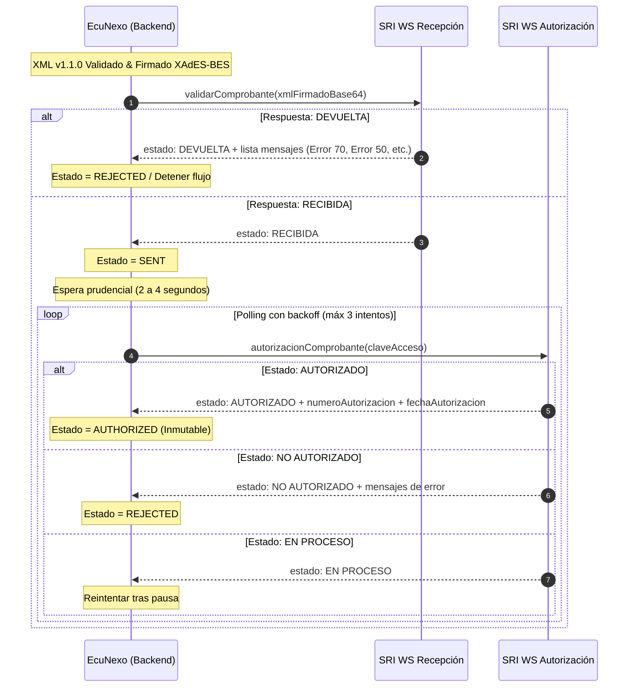

# Protocolo de Autorización SOAP con el SRI

La transmisión y autorización de comprobantes electrónicos en Ecuador se realiza mediante dos WebServices SOAP independientes bajo el modelo Offline.

---

## 1. Endpoints Oficiales del SRI

### Ambiente 1: Pruebas (Test / Celcer)
- **Recepción de Comprobantes:**
  `https://celcer.sri.gob.ec/comprobantes-electronicos-ws/RecepcionComprobantesOffline?wsdl`
- **Autorización de Comprobantes:**
  `https://celcer.sri.gob.ec/comprobantes-electronicos-ws/AutorizacionComprobantesOffline?wsdl`

### Ambiente 2: Producción (Cel)
- **Recepción de Comprobantes:**
  `https://cel.sri.gob.ec/comprobantes-electronicos-ws/RecepcionComprobantesOffline?wsdl`
- **Autorización de Comprobantes:**
  `https://cel.sri.gob.ec/comprobantes-electronicos-ws/AutorizacionComprobantesOffline?wsdl`

---

## 2. Flujo Transaccional en Dos Pasos

---

## 3. Manejo de Errores y Contingencia Offline

1. **Indisponibilidad del WebService (HTTP 500 / Timeout):**
   - El comprobante permanece en estado `SENT` o `SRI_UNAVAILABLE`.
   - El sistema no debe generar una nueva clave de acceso ni duplicar el secuencial.
   - Un worker en segundo plano reintenta periódicamente la consulta de autorización por Clave de Acceso.
2. **Error 43 (Clave Registrada):**
   - Si la recepción devuelve clave registrada, significa que el SRI ya procesó el comprobante previamente. El sistema debe saltar directamente al WebService de Autorización con esa clave.
