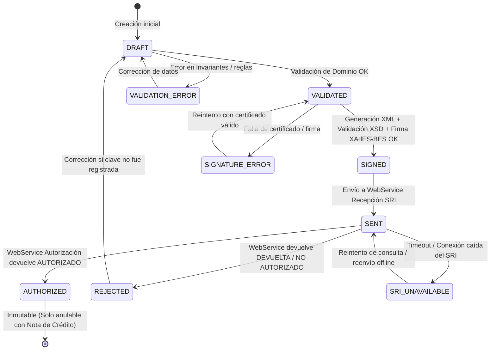

# Ciclo de Vida y Workflow de la Factura Electrónica

Una factura electrónica no es solo un registro en base de datos; es un proceso transaccional con una máquina de estados finitos regida por la normativa del SRI.

---

## 1. Diagrama de Estados (State Machine)

---

## 2. Descripción de Estados y Transiciones

| Estado | Descripción | Operaciones Permitidas |
| :--- | :--- | :--- |
| **`DRAFT`** | La factura se encuentra en edición. No tiene validez legal. | Edición de líneas, cliente, precios. Cálculo de totales preliminares. |
| **`VALIDATED`** | Ha superado todas las invariantes normativas (`invariants.yaml`) y cálculos (`calculations.yaml`). Se asigna secuencial definitivo. | Disparo de generación de Clave de Acceso y XML. |
| **`SIGNED`** | XML v1.1.0 generado, validado contra `Factura_V1.1.0.xsd` y firmado con XAdES-BES. | Transmisión al WebService del SRI. No se permite editar XML. |
| **`SENT`** | XML entregado al WebService de Recepción del SRI con respuesta `RECIBIDA`. | Consulta periódica al WebService de Autorización. |
| **`AUTHORIZED`** | El SRI autorizó formalmente el comprobante. Posee número y fecha de autorización oficial. | Generación de RIDE (PDF), envío por email al cliente, asiento contable. **INMUTABLE**. |
| **`VALIDATION_ERROR`** | El documento incumple reglas de negocio o normativas (ej. Consumidor Final > $50). | Notificación al usuario y retorno a edición. |
| **`SIGNATURE_ERROR`** | Certificado digital expirado, RUC no coincide o contraseña incorrecta. | Notificación administrativa de certificado. |
| **`REJECTED`** | El SRI rechazó el documento (`DEVUELTA` o `NO AUTORIZADO`) con mensajes de error. | Análisis del código de error SRI y corrección. |
| **`SRI_UNAVAILABLE`** | Caída de red, HTTP 500 o timeout en el SRI. Comprobante queda en cola offline. | Reenvío automático según política de reintentos con backoff. |

---

## 3. Principio de Inmutabilidad Tributaria

> [!IMPORTANT]
> Una vez que la factura alcanza el estado **`AUTHORIZED`**, queda estrictamente **PROHIBIDO**:
> - Modificar cualquier valor, fecha, detalle o identificación en la base de datos.
> - Eliminar el registro físico o lógico de la factura.
> 
> Si el emisor requiere anular o modificar una factura autorizada, el único mecanismo legal tributario es emitir una **Nota de Crédito Electrónica (Tipo 04)** conforme a [nota-credito-sri-ecuador/SKILL.md](file:///home/solivo/Documentos/ecunexo/Facturacion/.agents/nota-credito-sri-ecuador/SKILL.md).
