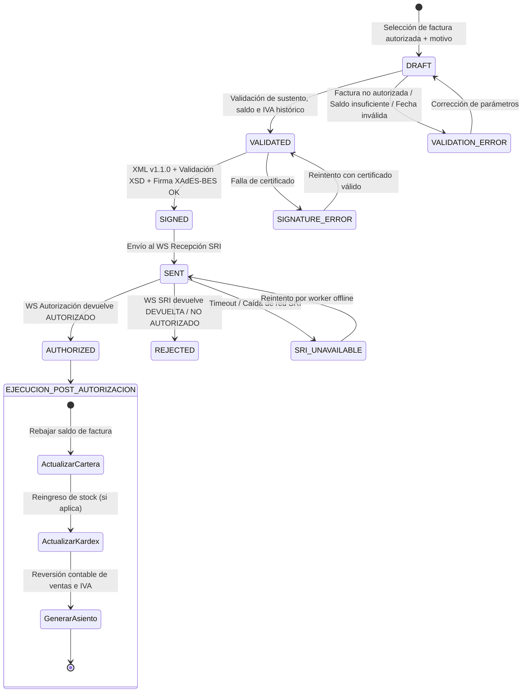

# Ciclo de Vida y Workflow de la Nota de Crédito

La emisión de una Nota de Crédito exige la validación previa del estado de la factura de sustento y coordina la actualización transaccional de cartera, inventario y contabilidad.

---

## 1. Diagrama de Estados (State Machine)

---

## 2. Invariantes de Transición y Bloqueos de Concurrencia

1. **Condición de Entrada (`DRAFT`):**
   - La Factura original referenciada debe encontrarse estrictamente en estado `AUTHORIZED`. No se puede emitir NC sobre facturas en estado `Draft`, `Signed`, `Sent` o `Rejected`.
2. **Bloqueo de Concurrencia (`BlocksNewCreditNote`):**
   - Si la Factura ya tiene una Nota de Crédito en estado `Draft`, `Validated`, `Signed` o `Sent`, el sistema **DEBE BLOQUEAR** la creación de una nueva Nota de Crédito hasta que la primera finalice en `AUTHORIZED` o sea rechazada formalmente (`Returned` o `NotAuthorized`). Esto evita que dos notas de crédito simultáneas excedan el saldo disponible de la factura.
3. **Ejecución Atómica Post-Autorización:**
   - La afectación a Cuentas por Cobrar (A/R), Kárdex (CPP) y el Asiento Contable deben ejecutarse de manera atómica (Unit of Work / Transacción de BD). Si falla la actualización del Kárdex, la transacción debe revertirse y reintentarse por un worker de consistencia eventual.
